<!--
  README de perfil do GitHub — Pedro Henrique
  Perfil: PH-dev30
  Personalize as tecnologias conforme sua experiência real.
-->

<!-- BANNER SUPERIOR -->

  

<!-- TEXTO ANIMADO -->

  

<!-- APRESENTAÇÃO -->
<h2 align="center">👨‍💻 Sobre mim</h2>

  Olá! Sou <strong>Pedro Henrique</strong> (<strong>PH-dev30</strong>).
  Este é meu espaço para compartilhar projetos, experimentos e aprendizados em programação.

  🚀 Explorando novas tecnologias 
  💡 Desenvolvendo projetos pessoais e colaborativos 
  🎯 Aprendendo e evoluindo a cada projeto

 

<!-- TECNOLOGIAS -->
<h2 align="center">📚 Tecnologias em aprendizado</h2>

  

  
    Sempre aprendendo mais!
  

 

<!-- PROJETOS -->
<h2 align="center">🚀 Projetos em destaque</h2>

<table align="center">
  <tr>
    <td valign="top">
      <h3 align="center">🏋️ Gestão de Academia — React Web + Mobile</h3>
      

        Projeto colaborativo organizado em um monorepo, reunindo as versões web e mobile.
        O repositório está hospedado no GitHub de um colega.
      

      

        
      

      

        
          Repositório externo ao perfil PH-dev30. Consulte o README do projeto para detalhes de instalação e tecnologias.
        
      

    </td>
  </tr>
</table>

<table align="center">
  <tr>
    <td valign="top">
      <h3 align="center">🍄 Super Mario POO — Java</h3>
      

        Um jogo de plataforma 2D inspirado no clássico Super Mario, desenvolvido inteiramente em Java. O projeto foi construído do zero, sem o            uso de motores gráficos prontos (como Unity ou Godot), com o objetivo de aplicar na prática conceitos fundamentais de Programação                 Orientada a Objetos (POO).
      

      

        
      

      

        
          Consulte o README do projeto para detalhes de instalação e tecnologias.
        
      

    </td>
  </tr>
</table>

  

 

<!-- ESTATÍSTICAS -->
<h2 align="center">📊 Estatísticas do GitHub</h2>

  
  

 

<!-- SEQUÊNCIA DE CONTRIBUIÇÕES -->
<h2 align="center">🔥 Sequência de contribuições</h2>

  

 

<!-- BEGIN ACTIVITY-GRAPH -->
<picture>
  <source media="(max-width: 767px)" srcset="activity-graph-mobile.svg">
  
</picture>
<!-- END ACTIVITY-GRAPH -->

 

<!-- CONTATO -->
<h2 align="center">📫 Vamos conversar?</h2>

  
  
   
  

<!-- BANNER INFERIOR -->

  

